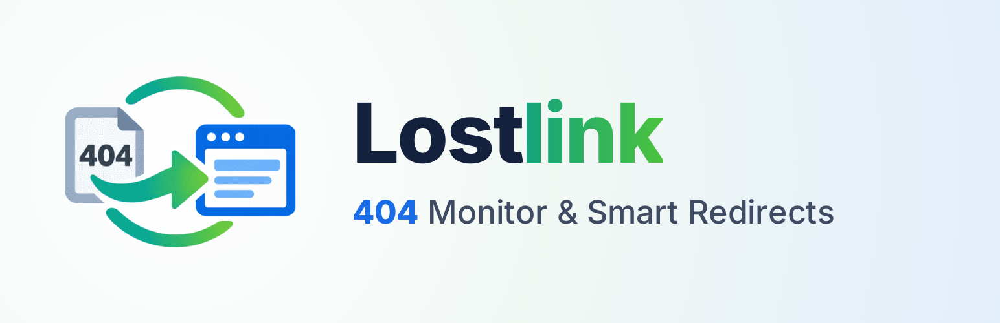
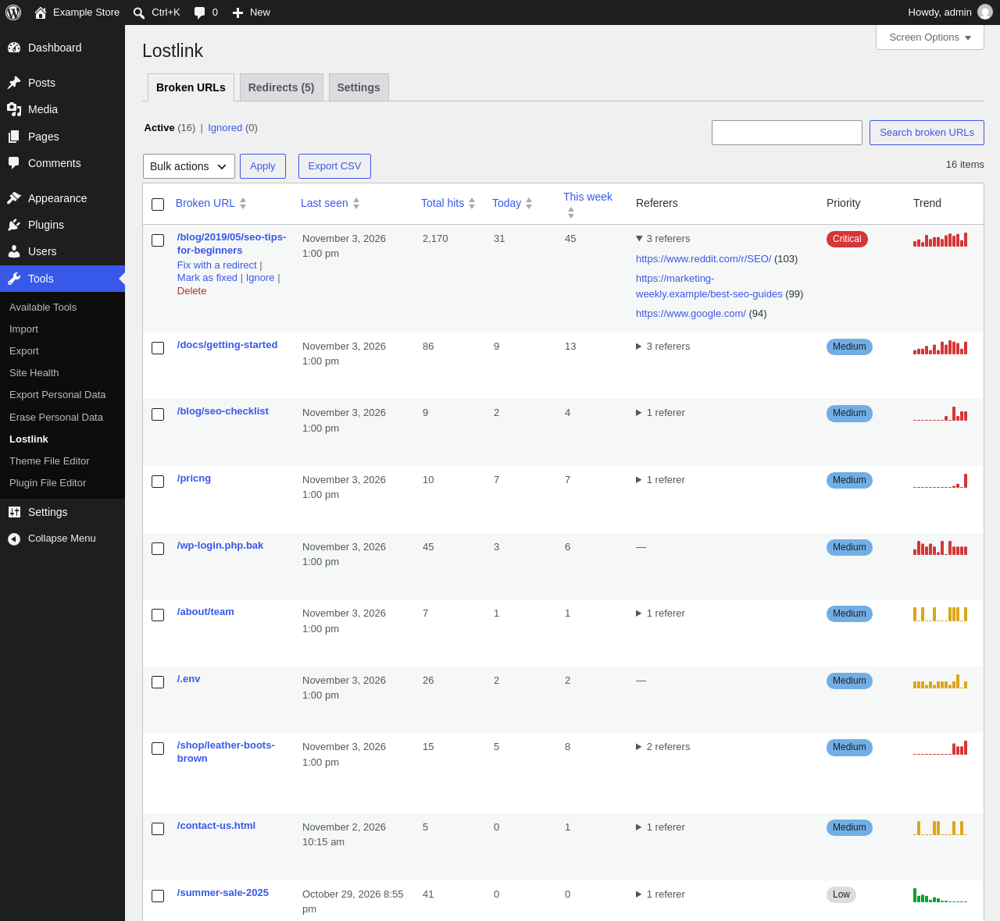

# Lostlink – 404 Monitor & Smart Redirects

[](https://github.com/elfifou/lostlink-wordpress/actions/workflows/ci.yml)


A WordPress plugin that finds the broken URLs that cost you visitors, ranks them by priority and fixes them with the right 301 redirect in one click.

- Records every 404 served by WordPress, per URL, with its referers and a 14-day history.
- Ranks the broken URLs by priority (Critical, High, Medium, Low) on a dashboard in Tools > Lostlink.
- Suggests the closest published content as the redirect target, and creates the redirect in the Redirection plugin or in its own built-in redirects.
- Supports Polylang, WP-CLI, and imports the 404 log of Redirection.

The full description, FAQ and changelog are in [readme.txt](readme.txt), the WordPress.org readme.



## Requirements

- WordPress 6.5 or later
- PHP 8.1 or later

## Development

The development tools are installed with `composer install`. On every push, [GitHub Actions](.github/workflows/ci.yml) runs:

- [WordPress Coding Standards](https://github.com/WordPress/WordPress-Coding-Standards) and PHPCompatibility, see `phpcs.xml.dist`;
- [PHPStan](https://phpstan.org/) at level max with the strict rules and the WordPress extension, without baseline, see `phpstan.neon.dist`;
- PHPUnit on the WordPress test suite, see `phpunit.xml.dist` and `tests/`, on PHP 8.1 and 8.4, WordPress 6.5 and latest;
- [Plugin Check](https://wordpress.org/plugins/plugin-check/), on the release archive.

The release archive is built with [`wp dist-archive`](https://github.com/wp-cli/dist-archive-command), which leaves out the files listed in `.distignore`:

```
wp dist-archive . --plugin-dirname=lostlink
```

The WordPress.org assets (icon, banners, screenshots) are in `.wordpress-org/`.

## Contributing

Bugs and feature requests are welcome in the [issues](https://github.com/elfifou/lostlink-wordpress/issues). For help, use the [WordPress.org support forum](https://wordpress.org/support/plugin/lostlink/). Security issues are reported privately, see [SECURITY.md](SECURITY.md).

## License

[GPL-2.0-or-later](LICENSE).
